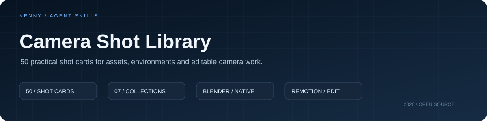

<p align="center"></p>

# Camera Shot Library

**用镜头说明结构，用运动建立空间。**

`50 shot cards` · `7 collections` · `Blender` · `Remotion` · `MIT`

作者与维护者：**李铿 / Kenny** · [GitHub](https://github.com/KKKKKennys)

An independently written set of practical shot instructions for 3D asset and environment presentation.

## 开始使用

[浏览 50 张卡片](references/catalog.md) · [Agent 入口](SKILL.md) · [Blender 实现](references/blender.md) · [检查清单](references/review.md)

围绕三维作品的实际展示需求，把常见的摄影、剪辑和动效方法编排成可选择、可执行、可核对的操作卡。说明、任务组织和软件适配由 Kenny 在 AI 协助下编写；这些卡片不宣称发明新的摄影技法。

## 卡片目录

| 系列 | 数量 |
|---|---:|
| 建立与基础 | 8 |
| 空间探索 | 8 |
| 资产与结构 | 8 |
| 光影与焦点 | 6 |
| 转场与衔接 | 8 |
| 节奏组织 | 6 |
| 制作过程与收尾 | 6 |

每张卡说明观看目的、起止构图、三维执行、时间组织、后期适配与验收重点。时长为规划建议，实际使用仍需依据场景与素材核对。

## 安装与调用

将整个仓库以 `camera-shot-library` 为目录名放入 `~/.codex/skills/`，或交给支持 `SKILL.md` 的 Agent。执行动画需要对应的软件连接与运行环境。

```text
使用 $camera-shot-library 为 Blender 中的硬表面资产设计一段运镜。
先展示完整外形，再观察装配结构，保留可编辑相机与物体动画。
沿用现有素材和时长，先输出镜头方案。
```

```text
使用 $camera-shot-library 调整现有片段的减速、停留和切点。
保持已确认的音乐、画幅和内容，不额外制作演示。
```

## 实际作品语境

- [AK-50 硬表面展示](https://kkkkkennys.github.io/#ak50)：完整外形、结构拆装与细节观察。
- [NEREID 深海科研站](https://kkkkkennys.github.io/#nereid)：空间建立、通道运动和白模到成品的呈现。

这些作品是既有工作流实践。本库是后续整理的独立指令版本，沿用已有视频作为相关作品说明；本次没有重新制作演示片，也没有宣称 50 张卡均已逐一实渲验证。

## 仓库内容

- `SKILL.md`：任务范围、选型、软件适配与交付规则
- `cards/`：50 张重新编写的操作卡
- `catalog.json`：可供工具检索的镜头目录
- `references/`：Blender 实现、镜头简报与检查规范

本包为制作指令和文档，不包含第三方示例源码、用户工程或成片。采用 [MIT License](LICENSE)。
